# Coordinating crowds: congestion, information and correlated equilibrium

*Foundations of AI (multi-agent systems) course project, IIT Gandhinagar*

| | |
|---|---|
| 🌐 **Website** (the story in one page) | **https://yashg1836.github.io/crowd-congestion/** |
| 🧪 **Interactive lab** (run every experiment) | **https://crowd-congestion.streamlit.app/** |
| 📄 **Final report** (8 pages) | [report/main.pdf](report/main.pdf) · earlier version: [report/draft1.pdf](report/draft1.pdf) |
| 🧭 **Design** (model, proofs, plan) | [DESIGN.md](DESIGN.md) |
| 📊 **All numbers** | [results/RESULTS.md](results/RESULTS.md) (regenerated by `python experiments.py`) |

Many people share one bottleneck and each chooses **when** to use it: cars at a bridge, backups on a network
link, diners at a food court, students at the hostel mess. Everyone wants a convenient time and a short queue,
and every person who joins a queue delays everyone behind them. The facility usually has enough capacity over
the whole window; everyone just comes at once. **It is a coordination problem, not a capacity problem.**

We ask **what a crowd display should show, and to whom,** so that people's own choices lead to short waits. We
study the general congestion game first, then a detailed (synthetic) case study of the four IITGN messes
(3000 students, 3 meals of 2 hours each). The main tool is the **correlated equilibrium**: private advice that
each person *wants* to follow.

<p align="center"><br><sub>(a) website, (b) website: the rush jumping under a live counter, (c) lab: display policies, (d) lab: correlated recommendations</sub></p>

## Main findings

| | Finding | Experiment |
|---|---|---|
| 1 | **Selfish timing is costly everywhere.** Nash equilibria cost 3-8× the planner's optimum for roads, networks, restaurants, gyms and the mess: **132 student-hours lost per normal day** across the four messes. | E2 |
| 2 | **More information can make it worse.** If everyone reacts to yesterday's exact counter, the rush jumps between slots (76% switch daily) and the cost rises from 2.2 to **11.6 min**. Showing it to at most half the crowd, or adding private noise, removes most of the damage. | E3, E4, E5 |
| 3 | **Fresh beats stale.** Within one evening, a *live* counter used with the optimal go-now-or-wait policy (an MDP) lowers the cost from 3.77 to 2.75 min; a counter 10 minutes old makes it 4.84, worse than nothing. | E12 |
| 4 | **Recommendations from a Nash schedule are correlated equilibria**: rational students obey them, the outcome is the same in every behaviour model, nothing swings, and herding stops once 50-70% use them. | E3, E6 |
| 5 | **Advice alone cannot beat Nash in a large crowd** (proved, and confirmed by a best-CE linear program). But the CE obedience constraints give the **smallest reward** that makes the optimum self-enforcing: about 2.7 min of priority for 13% of students, and the cost falls **from 2.24 to 0.36 min (6×)**. | E6 |
| 6 | **Who causes the queue?** By Shapley value, students arriving at the start of the rush cause 6.0 min of queue each but suffer 2.1; later ones suffer more than they cause. The core is empty. Funding the rewards with Shapley-proportional fees is budget-balanced and leaves nobody more than 3 s worse off than under selfish play. | E13, E14 |
| 7 | **Learning agents.** With published waits, Hedge and regret matching reach a near-correlated equilibrium; bandit learners (ε-greedy, UCB1, EXP3) see only their own wait and learn worse; deterministic UCB1 makes identical students herd. | E7, E11 |
| 8 | Announcing slow nights helps on average (+1.1 min) but **hurts on normal nights**. A robust (minimax) choice of display, found with alpha-beta pruning in 14 of 30 simulations, picks the CE + reward. | E8, E15 |
| 9 | From scans alone we recover the serving rate (within 2-3% whenever a queue forms) and preferred times (97% within one slot), and forecast the next 30 minutes within 8-14%. | E1, E9 |

## Course topics used

| Topic taught | What we do with it |
|---|---|
| Intelligent agents | students and the mess office as agents (percepts: display; actions: slot; performance: cost) |
| Normal form & dominance | iterated elimination: when Late costs more than any peak, everyone rushes |
| Pure & mixed Nash equilibrium | best-response dynamics for 678 students; mixed equilibrium of the dinner game |
| Extensive form, backward induction, SGPE | a counter that shows earlier choices makes the game sequential; non-credible threats removed |
| Alpha-beta pruning | robust minimax choice of display policy, pruning simulations |
| Correlated equilibrium | CE/CCE linear programs; shuffled Nash advice; best-CE LP at scale; obedience reward |
| Core & Shapley value | who causes the queue; empty core; Shapley fees fund the rewards |
| Markov decision processes | go now or wait with a live counter, solved by value iteration |
| Multi-armed bandits, RL (Monte Carlo, TD) | ε-greedy (sample-average vs constant step), UCB1, EXP3 students |
| Fairness | group parity (flexible vs rigid, peak vs off-peak) and a Pareto check |

## Results gallery

All figures are produced by `python experiments.py`.

| | |
|---|---|
| **E2** Selfish vs planner (Jaiswal dinner) | **E3** Display policies × behaviour (30 seeds) |
| 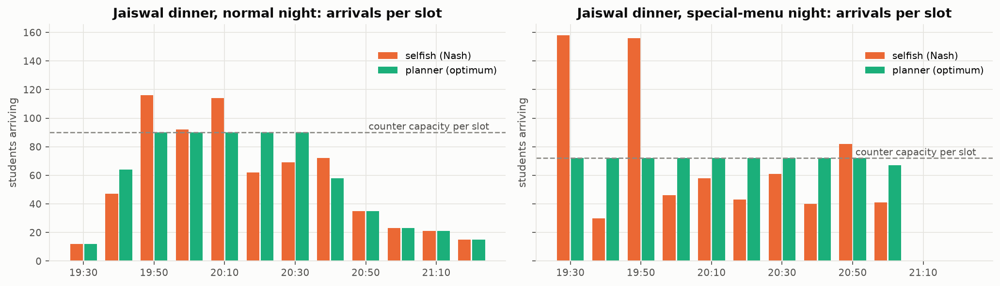 | 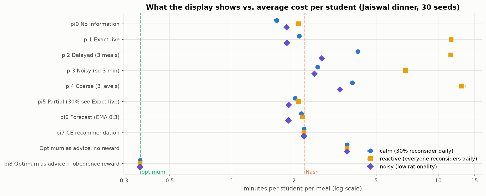 |
| **E6** Correlated recommendations and rewards | **E12** Go-now-or-wait MDP within an evening |
| 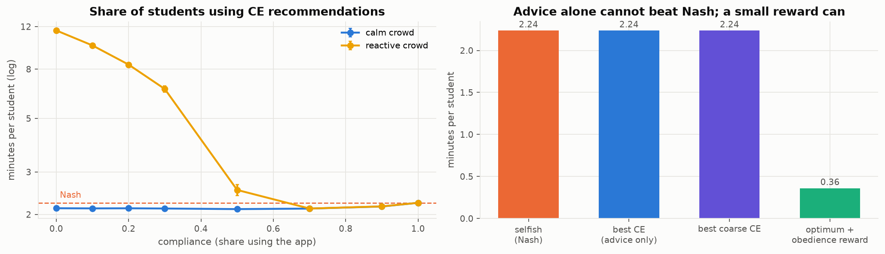 | 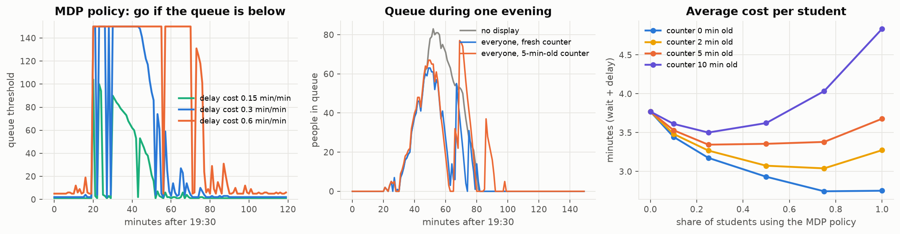 |
| **E13** Who causes the queue (Shapley value) | **E14** Who carries the cost (fairness) |
| 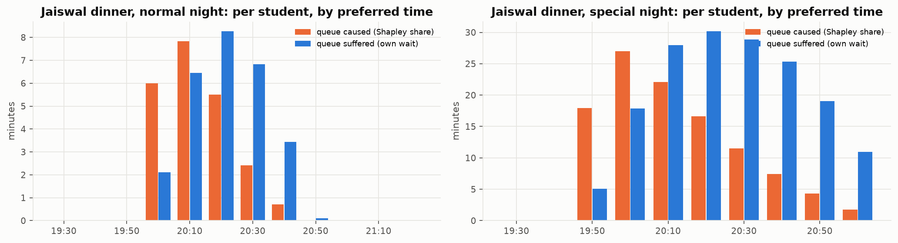 | 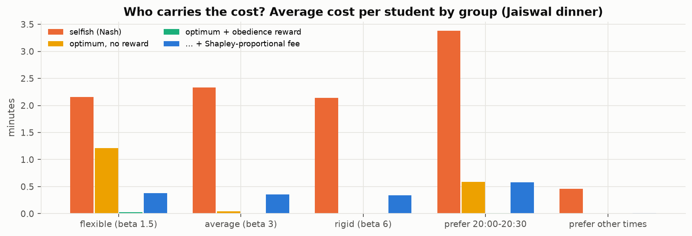 |
| **E11** Bandit and full-information learners | **E0** Small games: Pigou, learning to CE, delay stability |
| 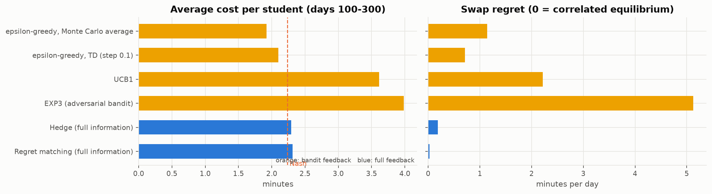 | 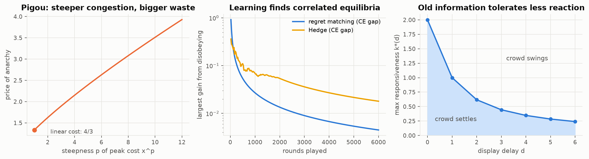 |
| **E4** Noise, share of viewers, display levels | **E5** Crowd swing vs delay and reactivity |
| 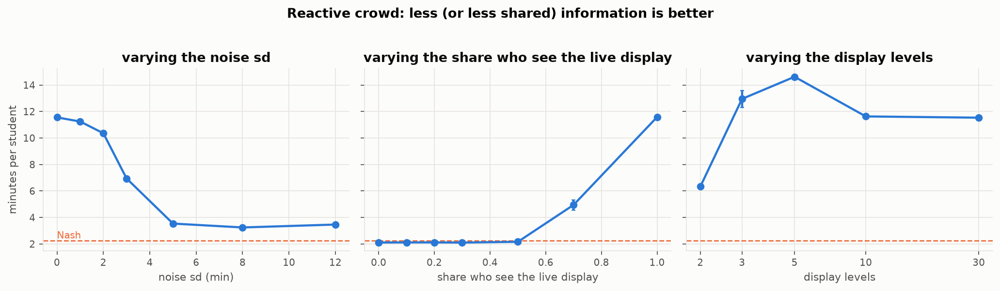 | 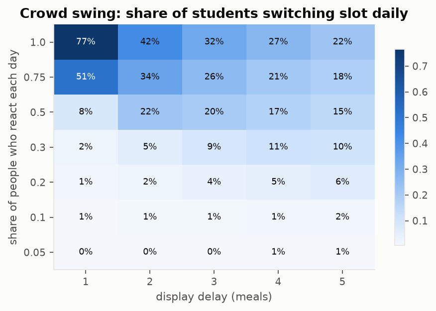 |
| **E1** Synthetic QR scans per 10 minutes | **E7** Learning curves |
| 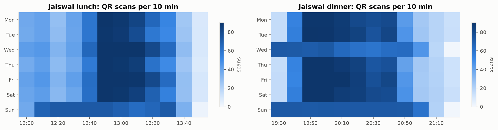 | 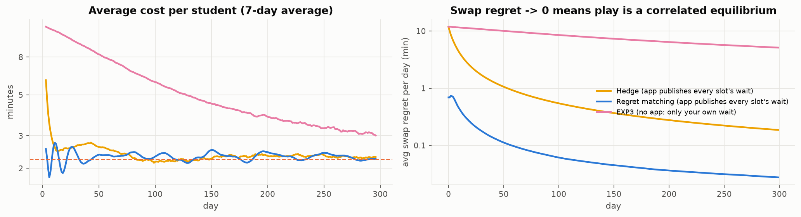 |

## Run it

```bash
git clone https://github.com/YashG1836/crowd-congestion.git && cd crowd-congestion
python -m venv .venv && source .venv/bin/activate     # Python 3.10+
pip install -r requirements.txt

pytest -q                     # 61 checks, ~10 s
python experiments.py         # E0-E15 -> results/ and docs/data.js (~4 min; --quick for 5 seeds)
streamlit run app.py          # the interactive lab
open docs/index.html          # the website, offline
```

The report compiles from inside `report/` with any LaTeX engine (for example `tectonic main.tex`).

## Repository

```
crowd/            the library, one file per layer
  theory.py       small games: dominance, Nash, CE/CCE LPs, backward induction, alpha-beta, learning, delay stability
  game.py         population slot game: fluid queue, Nash / Wardrop / optimum, price of anarchy
  correlated.py   recommendations, obedience, best-CE LP, Shapley value and core, fair scheme, Bayesian analysis
  simulate.py     day-to-day simulator (policies pi0-pi8, logit / bandit / no-regret students), go-or-wait MDP
  domains.py      the same model for roads, networks, restaurants, gyms and the mess
  mess.py         IITGN case study: scenario, synthetic QR-scan logs, calibration, nowcasting
  viz.py          shared colours
app.py            Streamlit lab
experiments.py    experiments E0-E15 -> results/ (figures + RESULTS.md) and docs/data.js
docs/             the website (GitHub Pages): index.html + data.js
tests/            tests for every quoted claim
report/           LaTeX report on the PRIMEarxiv template (main.tex/pdf; draft1.tex/pdf)
DESIGN.md         the full design
```

All data are synthetic and generated from a fixed seed in about a second, so nothing large is stored.

## Team

Harsh Kumar Jha · Yash Goyal · Piyush Kumar Keshri · Garv Singhal
