# Who should be told what? Coordinating crowds with correlated equilibrium

*Foundations of AI (multi-agent systems) course project, IIT Gandhinagar*

| | |
|---|---|
| 📄 **Final report** (8 pages) | [report/main.pdf](report/main.pdf) · LaTeX source: [report/main.tex](report/main.tex) · earlier draft: [report/draft1/main.pdf](report/draft1/main.pdf) |
| 🌐 **Website** (one page per step, with a guided demo) | **https://yashg1836.github.io/crowd-congestion/** |
| 🧪 **Interactive lab** (run every experiment) | **https://crowd-congestion.streamlit.app/** |
| 🧭 **Design** (model, proofs, experiments) | [DESIGN.md](DESIGN.md) |
| 📊 **All numbers** | [results/RESULTS.md](results/RESULTS.md) (regenerated by `python experiments.py`) |

Many people share one bottleneck and each chooses **when** to use it: cars at a bridge, backups on a network
link, diners at a food court, members at a gym, students at the hostel mess. Everyone wants a convenient time and
a short queue, and every person who joins a queue delays everyone behind them. The facility usually has enough
capacity over the whole window; everyone just comes at once. **It is a coordination problem, not a capacity
problem.**

We ask **what should be told to whom** so that people's own choices lead to short queues. Two ideas carry the
project: the **Nash equilibrium** (where selfish timing settles) and the **correlated equilibrium** (private advice
that each person *wants* to follow). We study crowd congestion in general on five facilities, then apply it to a
detailed (synthetic) case study of the four IITGN messes: 3000 students, 3 meals of 2 hours, 393,747 QR scans.

<p align="center">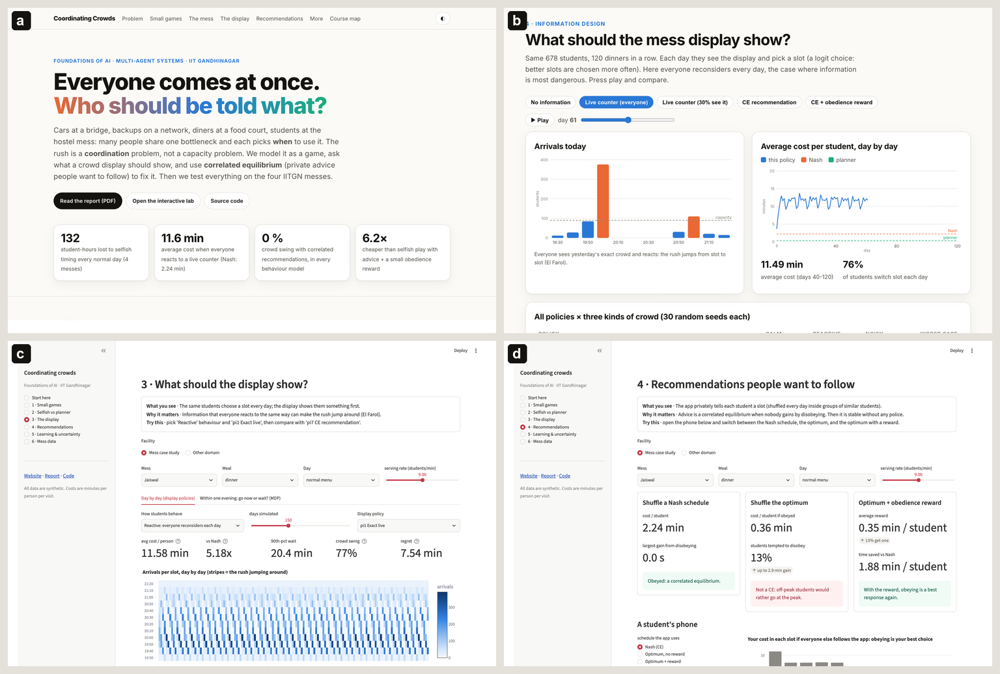<br><sub>(a) website overview, (b) a student's phone: the recommended slot is their cheapest choice, (c) lab: a public display makes the rush jump around, (d) lab: correlated advice and the obedience reward</sub></p>

## The story in five steps

| | Step | Finding | |
|---|---|---|---|
| 1 | **Selfish timing** | The Nash equilibrium costs **3.3–8.0×** the planner's schedule in all five facilities (1.7–3.4× when arrival times are random and the planner keeps a buffer); at the four messes that is **132 student-hours lost per normal day**. A booking system removes the queue but ignores who is flexible: about 2× the planner. | E2 |
| 2 | **Public display** | If everyone reacts to the same numbers, the rush jumps between slots: a public display costs **3.7–17× Nash** for a reactive crowd. Showing it to only 30% of people removes most of the damage. | E3 |
| 3 | **Private advice (CE)** | **Small crowds, solved exactly:** the best correlated equilibrium beats every pure Nash equilibrium (it closes **60%** of the gap to the planner at 10 people) and the advantage fades as the crowd grows. **Large crowds:** we prove the queue is monotone, which confines every CE to a small "best-response face"; searching it (3,000 schedules + column generation) finds **no CE cheaper than Nash**. Shuffled Nash advice is obeyed, never swings, and stops herding once 50–90% use it. | E1, E4, E8 |
| 4 | **Advice + reward** | The CE obedience constraints price the **smallest reward** that makes the optimum self-enforcing: every minute of reward saves 2.4–6.9 minutes and **nobody is worse off** than under selfish timing (Jaiswal dinner: **2.24 → 0.36 min**). Noisy (logit) users need a margin of 1–2 minutes on top. | E4, E7 |
| 5 | **Bad days** | *What* is said matters most: announcing a bad day **backfires** on the road (+20%) and, on severe days, in most facilities; a calibrated hint never does worse. Privacy (Bayes-correlated advice) pays in small crowds and on severe days, and adds little in large crowds on mild ones. | E5, E8 |
| | **Learning** | Regret-matching learners who see every slot's wait end near the CE (= Nash) set; learners who see only their own wait keep large regret. | E1, E6 |
| | **Mess data** | From scans alone we recover the serving rate (within 2–3% when a queue forms) and preferred times (97–100% within one slot), and forecast the next 30 minutes within 8–14% of the load. | E7 |

## Results obtained (screenshots)

The output of the test suite and of the full experiment run that produced every result in the report:

<p align="center">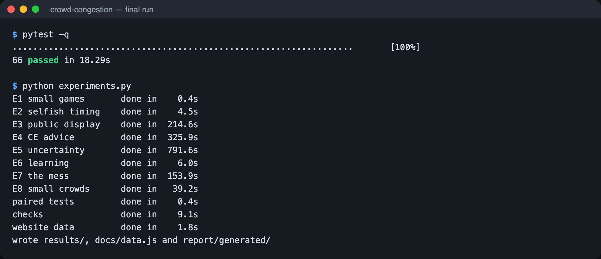</p>

### Where every table, figure and number of the report comes from

`python experiments.py` writes every figure, `results/RESULTS.md`, the website's data, **and the report's numbers and
tables** (`report/generated/numbers.tex` has one LaTeX macro per number quoted in the text; `report/generated/tab_*.tex`
are the tables). So `python experiments.py && cd report && tectonic main.tex` rebuilds `report/main.pdf` exactly.

| In the report | Experiment (function in `experiments.py`) | File written |
|---|---|---|
| Table 1, Fig. 1 (selfish timing, random-arrival robustness, booking) | E2 `e2_selfish` | `report/generated/tab_domains.tex`, `results/figures/fig2_selfish_vs_planner.png` |
| Fig. 2 (public display, 5 facilities × 3 crowds, paired tests) | E3 `e3_display`, `paired_tests` | `results/figures/fig3_public_display.png` |
| Fig. 3 (small crowds solved exactly; privacy on bad days) | E8 `e8_small_crowds` | `results/figures/fig9_small_crowds.png` |
| Table 2 (can any CE beat Nash? face search) | E4 `e4_ce` | `report/generated/tab_ce.tex` |
| Table 3 (price of obedience, noisy users) | E4 `e4_ce` | `report/generated/tab_advice.tex` |
| Table 4, Fig. 4 (bad days: who should be told what) | E5 `e5_information` | `report/generated/tab_bad.tex`, `results/figures/fig5_uncertainty.png` |
| Table 5, Fig. 5 (mess data and calibration) | E7 `e7_mess` | `report/generated/tab_data.tex`, `results/figures/fig6_mess_data.png` |
| Two-player games, learning | E1 `e1_small_games`, E6 `e6_learning` | `results/RESULTS.md` |
| Verification checks (Section 3.4) | `checks` | `report/generated/numbers.tex` |
| Every number quoted in the text | all of the above | `report/generated/numbers.tex`, `results/RESULTS.md` |

## Results gallery

All figures are produced by `python experiments.py` (figures 1, 4, 7 and 8 below are extra views not used in the
8-page report).

| | |
|---|---|
| **E1** Small games: correlation beats Nash | **E2** Selfish timing vs the planner; robustness to random arrivals |
| 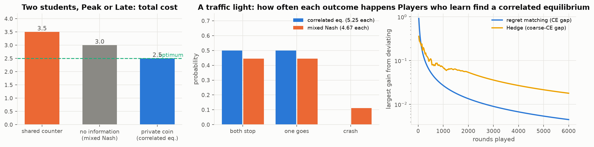 | 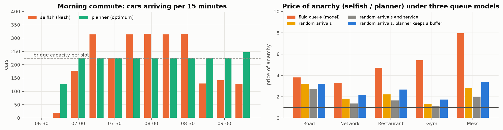 |
| **E3** Public display, five facilities × three crowds | **E4** How many must use the app; price of obedience |
| 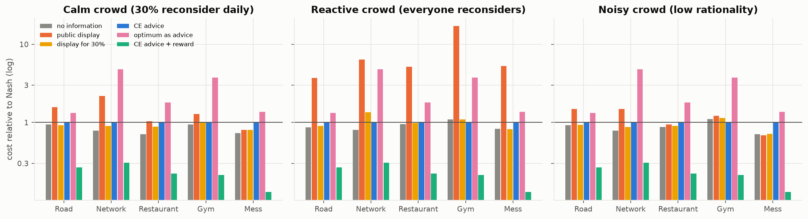 | 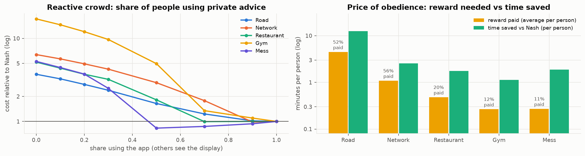 |
| **E5** When announcing a bad day backfires; the road's value of beliefs | **E7** Mess: QR scans and every meal |
| 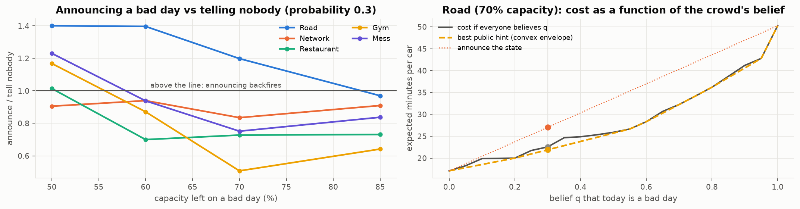 | 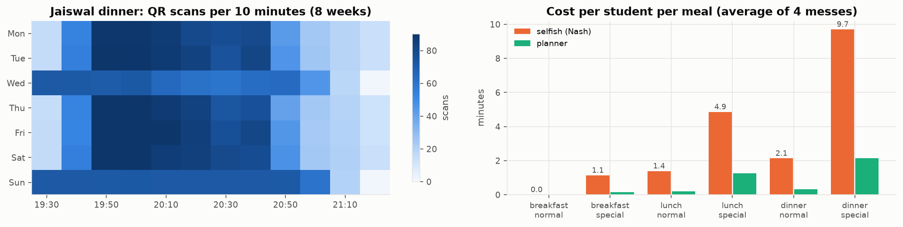 |
| **E7** Jaiswal dinner, day by day | **E7** Who should see the display; delay and swing |
| 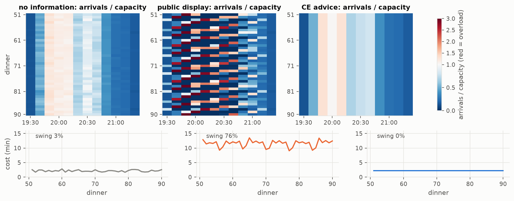 | 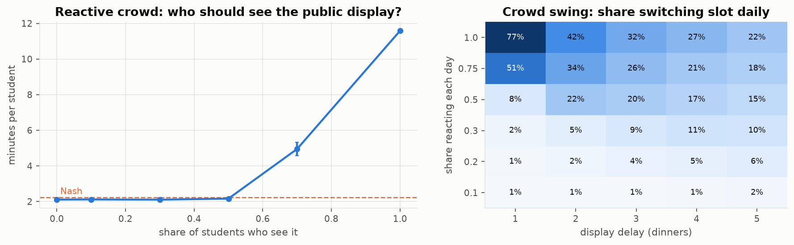 |
| **E8** Small crowds solved exactly; privacy on bad days | |
| 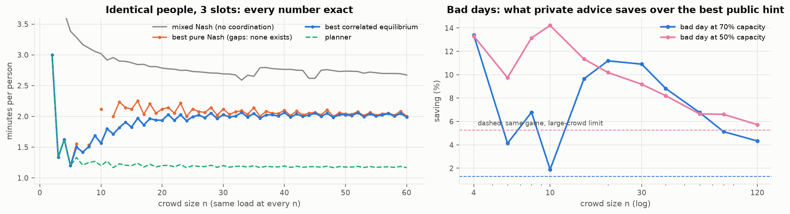 | |

## Run it

```bash
git clone https://github.com/YashG1836/crowd-congestion.git && cd crowd-congestion
python -m venv .venv && source .venv/bin/activate     # Python 3.10+
pip install -r requirements.txt

pytest -q                     # 66 checks
python experiments.py         # E1-E8 (~30 min; --quick for 5 seeds): results/, docs/data.js, report/generated/
cd report && tectonic main.tex && cd ..   # rebuild the report from those numbers (any LaTeX engine works)
streamlit run app.py          # the interactive lab
open docs/index.html          # the website, offline
```

## Repository

```
crowd/            the library, one file per layer
  theory.py       small games: Nash and correlated equilibria (LPs), Pigou, learning (regret matching, Hedge)
  game.py         slot game: fluid queue, Nash / large-crowd (Wardrop) / optimum solvers, price of anarchy,
                  random-arrival queue check, slot booking
  correlated.py   shuffled recommender, obedience, best-CE LPs, obedience reward, who gains, bad-day information design,
                  the best-response-face search (queue lemma + column generation)
  smallcrowd.py   small crowds of identical people solved exactly: best CE, pure and mixed Nash, bad days, privacy
  simulate.py     day-to-day simulator: display policies, logit behaviour, Hedge / EXP3 / regret-matching learners
  domains.py      the same model for roads, networks, food courts, gyms and the mess
  mess.py         IITGN case study: scenario, synthetic QR-scan logs, calibration, forecasting
  viz.py          shared colours
app.py            Streamlit lab (start here, small games, selfish vs planner, display, advice, mess, team)
experiments.py    experiments E1-E8 -> results/, docs/data.js and report/generated/
docs/             the website (GitHub Pages): index.html, style.css, app.js, data.js, img/
tests/            tests for every quoted claim
report/           LaTeX report on the PRIMEarxiv template: main.tex/pdf, generated/ (numbers and tables written by
                  experiments.py); draft1/ = the earlier draft
DESIGN.md         the design
```

All data are synthetic and generated from a fixed seed in a few seconds, so nothing large is stored. Photos on the
website come from Wikimedia Commons: Countryball mys123 (CC BY 4.0), Freooudzao (CC BY-SA 4.0), BalticServers.com
(CC BY-SA 3.0), U.S. Air Force / Staff Sgt. Araceli Alarcon (public domain).

## Team

| Name | Roll no. | Branch | Email | Main contribution |
|---|---|---|---|---|
| Yash Goyal | 24110399 | Computer Science and Engineering | yash.g@iitgn.ac.in | project lead and integration; bad days, learning; report, website, lab |
| Harsh Kumar Jha | 24110130 | Artificial Intelligence | harsh.jha@iitgn.ac.in | mess data and calibration; exact small crowds, noisy users, robustness |
| Piyush Kumar Keshri | 24110260 | Chemical Engineering | piyush.keshri@iitgn.ac.in | equilibria, correlated-equilibrium programs, Propositions 1–3 |
| Garv Singhal | 24110119 | Computer Science and Engineering | garv.singhal@iitgn.ac.in | day-to-day simulator, display policies, facilities |

The contribution section of the report lists each member's assigned task and whether it was fulfilled.
