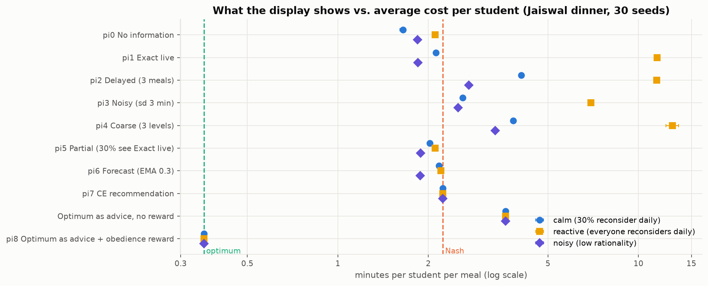
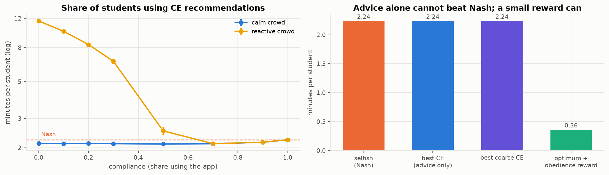
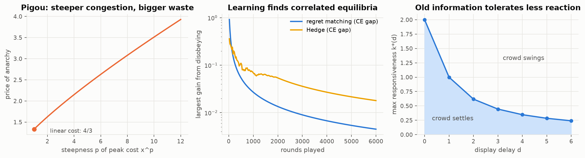
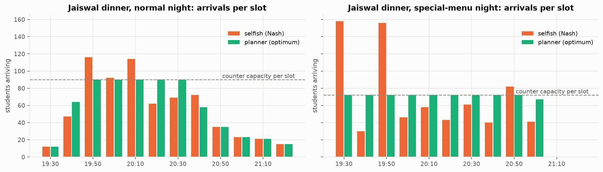
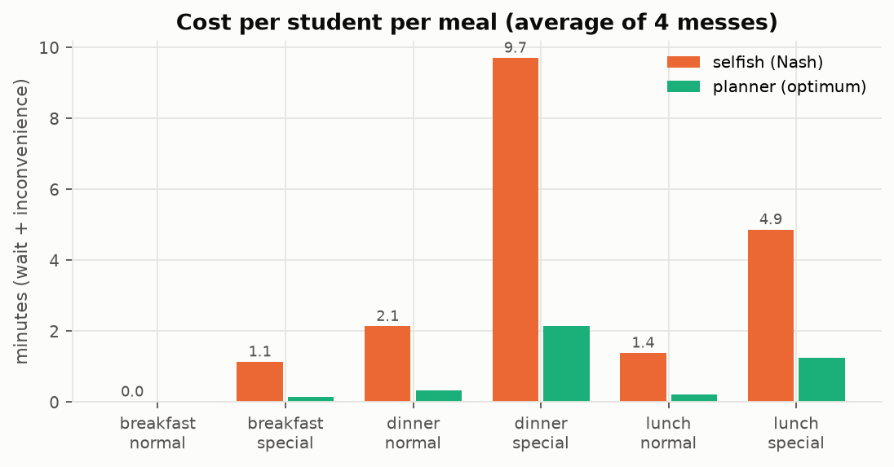
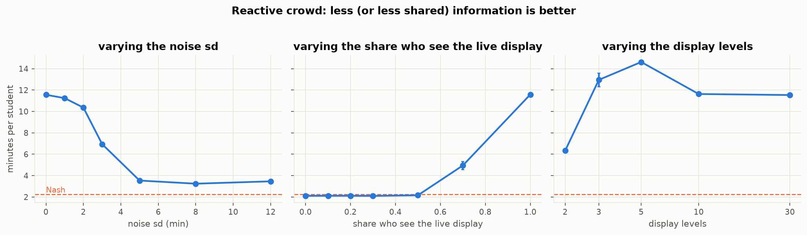
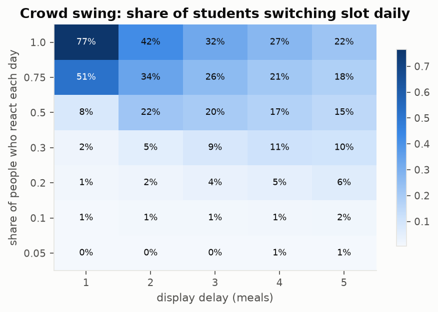
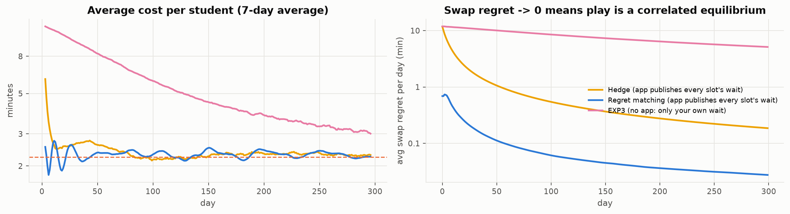
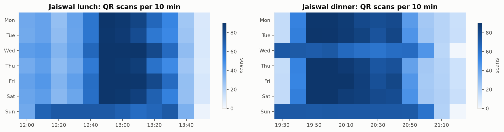
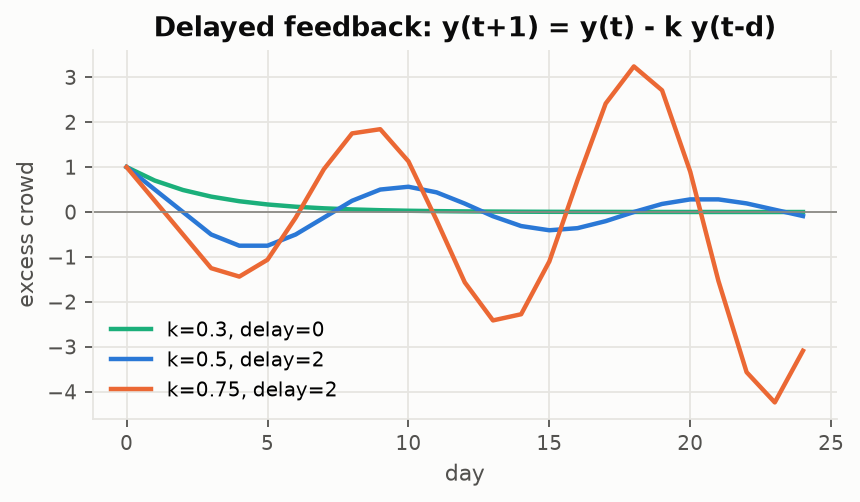

# Crowd congestion, information and correlated equilibrium

*Foundations of AI (multi-agent systems) course project, IIT Gandhinagar*

Many people share one bottleneck and each chooses **when** to use it: cars on a
bridge, backups on a network link, diners at a food court, students at the
hostel mess. Each person wants a convenient time and a short queue, but each
one who joins the queue delays everyone behind them. The facility usually has
enough capacity over the whole window; everyone just comes at once.
**It is a coordination problem, not a capacity problem.**

A crowd display looks like the obvious fix, but if everyone reacts to the same
number the rush simply moves. We ask **what a display should show, and to whom,**
so that people's own choices lead to short waits. We answer with congestion
games, information design and, centrally, the **correlated equilibrium**: a
private recommendation that each person *wants* to follow. We build the theory
in general, then test it on a detailed (synthetic) case study of the four IITGN
messes (3000 students, 3 meals of 2 hours each).

> **Live demo: [https://crowd-congestion.streamlit.app/](https://crowd-congestion.streamlit.app/)**
> Final report (8 pages): **[report/main.pdf](report/main.pdf)**.
> Full plan, model, proofs and experiment design: **[DESIGN.md](DESIGN.md)**.
> All numbers: **[results/RESULTS.md](results/RESULTS.md)** (regenerated by `python experiments.py`).

## Main findings

| | Finding | Evidence |
|---|---|---|
| 1 | **Selfish timing is costly everywhere.** Nash equilibria cost 3-8× the planner's optimum for roads, networks, restaurants, gyms and the mess; across the four messes it is **132 student-hours lost per normal day**. | E2 |
| 2 | **More information can make it worse.** If everyone reacts to an exact live counter, the rush jumps between slots (76% of students switch each day) and the average cost rises from 2.2 to **11.6 min**. Showing it to at most half the crowd, or adding private noise, removes most of the damage. | E3, E4 |
| 3 | **Delayed displays make the crowd swing**, as predicted by y(t+1) = y(t) − k·y(t−d) with stability limit k\*(d) = 2 sin(π/(4d+2)). | E0, E5 |
| 4 | **Private recommendations drawn from a Nash schedule are correlated equilibria.** Rational students obey them, the outcome is the same in every behaviour regime, there is zero swing, and herding disappears once 50-70% of students use them. | E3, E6 |
| 5 | **Advice alone cannot beat Nash in a large crowd** (proved in DESIGN.md §4.3; our best-CE linear program confirms it). However, the CE obedience constraints give the **smallest reward** that makes the optimum self-enforcing: the 13% sent off-peak get about 2.7 minutes' worth of priority, and the average cost falls **from 2.24 to 0.36 min (6×)**. | E6 |
| 6 | Learning connects to CE: regret-matching students reach a correlated equilibrium on their own when the app publishes waits; without published data (EXP3) learning stalls. | E0, E7 |
| 7 | Announcing slow nights helps on average (+1.1 min per student) but **hurts on normal nights**: the fear of a slow night was keeping people spread out. | E8 |
| 8 | From scans alone we recover the serving rate (within 2-3% whenever a queue forms) and preferred times (97% within one slot), and forecast the next 30 minutes within 8-14% of the load. | E1, E9 |

<p align="center"></p>
<p align="center"></p>

## The idea in three small games

* **Pigou's network**: selfish routing costs 4/3 of the optimum with linear
  costs, and more when congestion is steep (2.15 for x⁴).
* **Two-student dinner game**: a shared counter both react to → 3.5; no
  information (mixed Nash) → 3.0; a private fair coin ("you Peak, you Late"),
  which is a correlated equilibrium → **2.5 = optimum**.
* **Intersection (traffic light)**: the best correlated equilibrium gives each
  driver 5.25, more than any mixture of Nash equilibria (4.67).

<p align="center"></p>

## Results gallery

All figures are produced by `python experiments.py` (numbers in [results/RESULTS.md](results/RESULTS.md)).

| | |
|---|---|
| **E2** Selfish vs planner arrivals (Jaiswal dinner) | **E2** Cost per student by meal |
|  |  |
| **E4** Noise, share of viewers, display levels (reactive crowd) | **E5** Crowd swing vs delay and reactivity |
|  |  |
| **E7** Learning: Hedge, regret matching, EXP3 | **E1** Synthetic QR scans per 10 minutes |
|  |  |
| **E0** Delayed feedback paths | |
|  | |

## Run it

```bash
git clone https://github.com/YashG1836/crowd-congestion.git && cd crowd-congestion
python -m venv .venv && source .venv/bin/activate     # Python 3.10+
pip install -r requirements.txt

pytest -q                     # 54 checks, ~10 s
python experiments.py         # all experiments -> results/ (~3 min; --quick for 5 seeds)
streamlit run app.py          # interactive demo in the browser
```

The report is compiled with any LaTeX engine from inside `report/` (for example `tectonic main.tex`).

Or open the hosted demo: **[https://crowd-congestion.streamlit.app/](https://crowd-congestion.streamlit.app/)**. The demo walks through the story: the overview, the toy games, selfish vs. planner,
display policies (pick any policy and behaviour and watch the rush move day by
day), correlated recommendations (including a student's phone view showing why
obeying is the best choice), learning and uncertainty, and the synthetic mess data.

## Repository

```
crowd/            the library, one file per layer
  theory.py       small games: Nash, correlated equilibrium LPs, Pigou, learning, delay stability
  game.py         population slot game: fluid queue, Nash / Wardrop / optimum, price of anarchy
  correlated.py   recommendations, obedience, price of obedience, best-CE LP, Bayesian analysis
  simulate.py     day-to-day simulator: display policies pi0-pi8, behaviour models
  domains.py      the same model for roads, networks, restaurants, gyms and the mess
  mess.py         IITGN case study: scenario, synthetic QR-scan logs, calibration
  viz.py          shared colours
app.py            Streamlit demo
experiments.py    experiments E0-E9 -> results/ (figures + RESULTS.md)
tests/            tests for every quoted claim
report/           final LaTeX report on the PRIMEarxiv template (main.tex, main.pdf)
DESIGN.md         the full design
```

All data are synthetic and generated from a fixed seed in about a second, so
nothing large is stored in the repo.

## Team

Harsh Kumar Jha · Yash Goyal · Piyush Kumar Keshri · Garv Singhal
